# Mon parcours jusqu'à maintenant ...

## Formation

:::: {.columns}
::: {.column width="15%"}
2011--2014
:::

::: {.column width="85%"}
**BAC Technologique STI2D ITEC**
:::
::::

:::: {.columns}
::: {.column width="15%"}
2014--2016
:::

::: {.column width="85%"}
**CPGE Techniques et Sciences Industrielles**
:::
::::

:::: {.columns}
::: {.column width="15%"}

2016--2020

:::

::: {.column width="85%"}

**ENS Paris-Saclay**

:::{.muted}
*Spécialisation en mécanique des matériaux.*
:::
:::
::::

:::: {.columns}
::: {.column width="15%"}
2020--2023
:::

::: {.column width="85%"}
**Thèse au Laboratoire de Mécanique Paris-Saclay**

:::{.muted}
*Encadrée par Rodrigue Desmorat et Cécile Oliver-Leblond*
:::

:::
::::

:::: {.columns}
::: {.column width="15%"}
2024--2026
:::

::: {.column width="85%"}
**Post-doctorat à l'IMSIA** (ENSTA)

:::{.muted}
*Encadré par Véronique Lazarus*
:::
:::
::::

## Thèse au LMPS

:::: {.columns}

::: {.column width="22%"}
**2020--2023**

{width="20%" .absolute top=16%}
:::

::: {.column width="57%"}
**Formulation de l'endommagement anisotrope   des matériaux et stuctures quasi-fragiles   basée sur la simulation discrète de la fissuration**
:::

::: {.column width="21%"}
R. Desmorat   C. Oliver-Leblond
:::

::::

[ **Model damage in micro-cracking material from discrete simulations** $\rightarrow \boldsymbol{\sigma} = \tilde{\mathbf{E}}(\mathbf{D}) : \boldsymbol{\varepsilon}$]{.alert}

::::{.columns}

:::{.column width=33%}
1. Discrete simulations

::: {layout-ncol=2}

:::{.footnotesize}
 
21 loads  
36 $\mu$-structures  
$\to$ 76k steps
:::

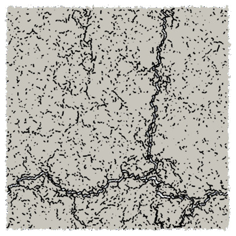{width=5cm}

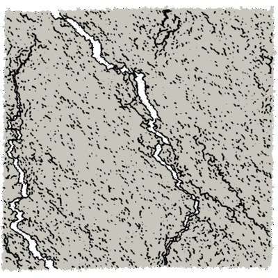{width=5cm}

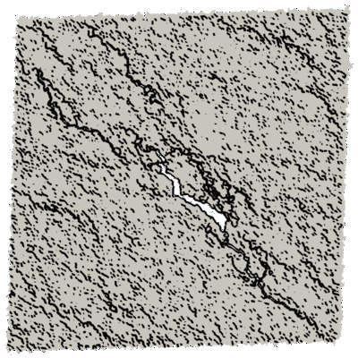{width=5cm}

:::

:::

:::{.column width=33%}
2. Effective elasticity tensors

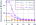{width=80%}

[ Analysis of symmetry classes]{.footnotesize}

:::

:::{.column width=33%}

3. Modelling

:::{.footnotesize}

a. Damage definition
  $$\mathbf{D} = \mathbf{1} - \frac{1}{\kappa_0} \mathrm{tr}_{12} (\mathbf{E})$$

b. Harmonic decomp.

:::

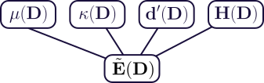{width=100%}

:::
::::

:::{.footer}
 @loiseau_anisotropic_2023 and @vedrine_calibration_2025 &emsp;  Dataset: [https://doi.org/10.57745/LYHM4W](https://doi.org/10.57745/LYHM4W)
:::

:::{.notes}
- Endommagement anisotrope des matériaux quasi-fragiles (hétérogènes)
- Basé sur simulation discrète (voir figure) représentant explicitement la micro-fissuration
- Idée : mesurer l'évolution du tenseur d'élasticité d'un VER sous différents chargements
- Ensuite, analyse via outils mathématiques (distance aux classes de symétrie)
- Ensuite, définition d'une variable d'endo puis formulation de la loi d'état : tenseur d'élasticité en fonction de l'endo via la décomposition harmonique.
- Cas de l'évolution : traité mais pasz abouti.
:::

## Postdoc - Overview

:::: {.columns}
::: {.column width="22%"}
**2024--2026**

{width="70%" fig-align="left"}
:::

::: {.column width="59%"}
**Theoretical and numerical study of crack propagation   in heterogenous and/or anisotropic materials**
:::

::: {.column width="19%"}
V. Lazarus
:::

::::

[** Open-source codes for 2D crack propagation**]{.alert .large}

::::{.columns}
:::{.column width=40%}

 

[[ **floiseau/gcrack**]{.example}](https://github.com/floiseau/gcrack) [(LEFM¹)]{.muted}

[[ **floiseau/fragma**]{.example}](https://github.com/floiseau/fragma) [(phase-field)]{.muted}

::::::{.columns}
:::::{.column width=55%}
- Load control   [(path-following)]{.muted}
- Fracture anisotropy
:::::

:::::{.column width=45%}

- Heterogeneities [(fragma)]{.muted}
- Fatigue [(gcrack)]{.muted}

:::::
::::::

:::

:::{.column width=60%}

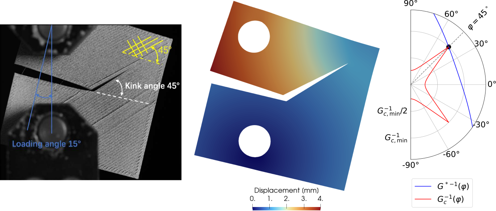{width=100%}

:::
::::

:::{.footer}
1. LEFM = Linear Elastic Fracture Mechanics
:::

## Postdoc - Numerical Aspects
[ Develop robust numerical tools for crack propagation in anisotropic materials]{.alert .large}

::::{.columns}

:::{.column width=33% .fragment}

#### Load control
:::{.footnotesize}
 @loiseau_path-following_2026
:::

Force load + Fracture = Instable

[ Novel path-following method]{.muted}

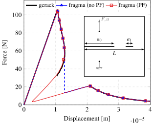{width=100%}

:::

:::{.column width=66% .fragment}

#### Limiting numerical bias in phase-field simulations of fracture

::::::{.columns}
:::::{.column width=37%}
**Initial cracks**

[ @loiseau_how_2025]{.footnotesize}

[ Initial crack in   &nbsp;&nbsp;&nbsp;&nbsp; phase-field fracture   &nbsp;&nbsp;&nbsp;&nbsp; with no bias]{.muted}

:::::

:::::{.column width=62%}
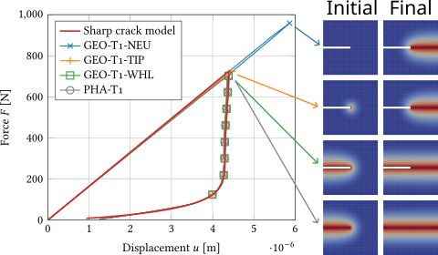{width=100%}
:::::
::::::

::::::{.columns .fragment}
:::::{.column width=38%}
**Mesh-induced bias**

[ Zembra \& Henry (PMC)]{.footnotesize}
[ Quantify mesh bias   &emsp;&nbsp; in crack path pred.]{.muted}
:::::

:::::{.column width=61%}
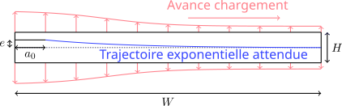{width=100%}
:::::
::::::

:::

::::

## Postdoc - Applications (non-exhaustive)

[ Predict crack propagation to design/optimize real systems]{.alert .large}  

::::{.columns}

:::{.column width=36% .fragment}

#### Fracture in 3D-printed structures 
 Thèse de K. Paquet

{width=55% fig-align=center}

:::

:::{.column width=64% .fragment}

#### Optimization of fracture properties *via* heterogeneities
 J. Triclot (LMA)  
[ Simulation of crack propagation with load control in gcrack]{.muted}

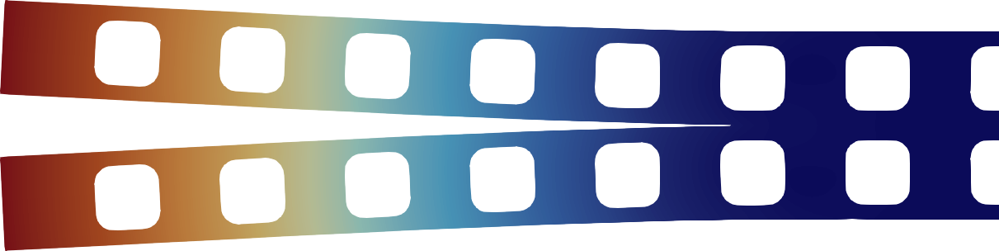{width=64% fig-align=center}

::::::{.columns .fragment}
:::::{.column width=55%}

#### Fracture in rotating structures
 G. Yakir \& P. Reis (EPFL)

[ Analytical model of the setup   &emsp;&nbsp; using sparse regressions]{.muted}

:::::

:::::{.column width=36%}
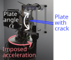{width=100%}
:::::

::::::

:::

::::

# .. et maintenant au LaMCoS

## Bonjour

- Enseignement : 50% FIMI / 50% GM.
- Recherche : LaMCoS, équipe MULTIMAP.

#### Sparse analytical regressions
[ Safran Aircraft Engines (discussion for applications)]{.verysmaller .muted}  
[&nbsp;&nbsp; Applications : Fracture in rotating structures]{.verysmaller .muted}  
&nbsp;&nbsp;&nbsp;&emsp;&emsp;&emsp;&emsp;&emsp;&emsp; [Revisiting fracture mechanics handbooks]{.verysmaller .muted}  
 Finding a sparse analytical expression from data  
[&emsp; Simplicity vs accuracy tradeoff]{.muted .verysmaller}
